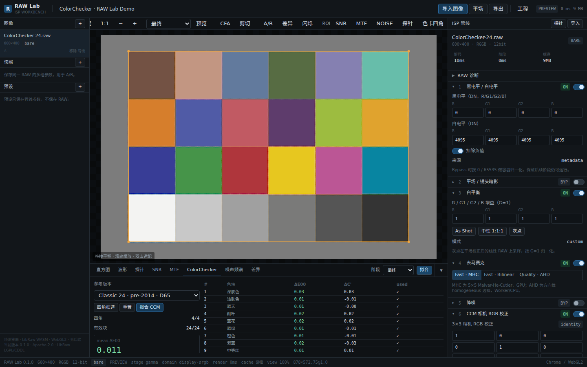
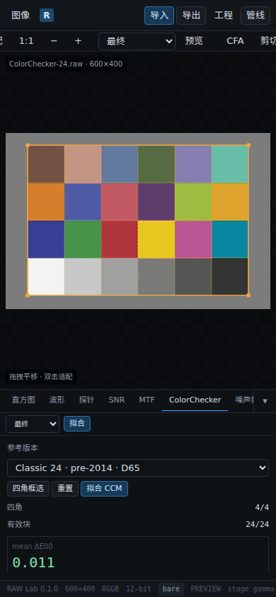
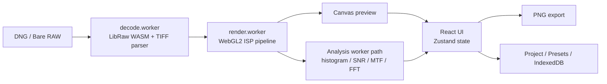

<div align="center">

# RAW Lab

**把 ISP 实验室装进浏览器。**

DNG / 裸 RAW → 黑白电平 → 平场 → 白平衡 → 去马赛克 → 降噪 → CCM → CSC → Gamma → USM → PNG  
解码、处理、分析、导出全部在本地完成，无后端、无上传、无账号。

[](https://github.com/xiaoqinxing/raw-image-tools/actions/workflows/ci.yml)
[](LICENSE)
[](https://raw-image.li.qinxing.xyz)
[](https://github.com/xiaoqinxing/raw-image-tools/actions)
[](#技术架构)
[](THIRD_PARTY_NOTICES.md)
[](#为什么是-raw-lab)

**[在线体验](https://raw-image.li.qinxing.xyz)** · **[核心功能](#核心功能)** · **[技术架构](#技术架构)** · **[本地运行](#本地运行)** · **[性能实测](#性能实测)**

</div>



<p align="center"><sub>ColorChecker Classic 24 拟合 · 合成测试图 mean ΔE00 = 0.011</sub></p>

## 为什么是 RAW Lab

大多数在线修图工具把 RAW 当成一张“更宽的 JPEG”：套滤镜、调曲线、导出，结束。

RAW Lab 反过来，把 **从 CFA 到 sRGB 的整条 ISP 管线摊开给你看**：

- **从 RAW 开始，而不是从成片开始**：LibRaw WASM 解包 DNG，裸 RAW 支持 CFA、位宽、packing、端序、stride、active area 与逐通道黑白电平。
- **每一步都可见、可调、可绕过**：10 个固定阶段，均可 bypass、A/B、查看中间结果、单独导出。
- **像素不离开浏览器**：无上传、无账号、无服务端推理。关掉网络也能继续处理已加载的图像。
- **工程级可复现**：参数、快照、预设、ROI、ColorChecker 与视图状态都能保存，方便反复验证。
- **性能不靠“云端显卡”**：WebGL2 管线、Worker 解码/分析、阶段缓存与降采样策略，让 24MP RAW 在普通桌面浏览器里保持可交互。

适合相机/ISP 工程师、影像算法工程师、摄影技术爱好者，以及需要演示 RAW 处理流程的教学和评测场景。

## 三步开始

1. **导入**：拖入 DNG，或按实际存储格式配置裸 RAW。
2. **拆解**：切换 10 个 ISP 阶段，做 A/B、差异图、闪烁对比或 2–4 图同步对比。
3. **分析 / 导出**：看直方图、SNR、MTF、噪声频谱、ColorChecker ΔE00，导出任意阶段的 PNG。

不用安装，直接打开 **[在线演示](https://raw-image.li.qinxing.xyz)**。

## 核心功能

### RAW 导入与诊断

- **DNG**：LibRaw WASM 解包像素，配合本地 TIFF/DNG 标签解析补齐 `ActiveArea`、`DefaultCrop`、`BlackLevel`、`WhiteLevel`、`ColorMatrix1/2`、`ForwardMatrix1/2`、`AsShotNeutral`、`CalibrationIlluminant`、`Orientation`、`BaselineExposure` 等元数据。
- **裸 RAW 二进制**：支持 RGGB / BGGR / GRBG / GBRG；8/10/12/14/16-bit；u8/u16、LE/BE、左/右对齐、sample shift；连续 packed 与 MIPI RAW10/12/14；header offset、row stride、active area、逐 CFA 黑白电平。默认黑白电平按位宽填充（10-bit 64/1023，12-bit 256/4095）。
- **导入即体检**：逐通道 min/p1/p50/p99/max、黑/白电平越界比例、G1/G2 一致性、字节差、警告与修正建议。
- **CFA 伪彩预览**：默认开启，切到 RAW / 平场 / 白平衡阶段即可确认 Bayer 相位与数据排布。
- **未执行项透明提示**：OpcodeList、LinearizationTable、BlackLevelDelta 等 DNG 标签不会静默忽略。

### 固定 10 阶段 ISP 管线

顺序固定，保证不同图像、不同参数之间可比较、可复现。

| # | 阶段 | 色彩域 | 实现 |
|---|------|--------|------|
| 1 | 黑/白电平 | raw CFA | GPU R16F |
| 2 | 平场 / 镜头暗影 | raw CFA | GPU 逐 CFA 增益，强度 / epsilon / max gain |
| 3 | 白平衡 | raw CFA | As Shot、手动、灰点吸管 |
| 4 | 去马赛克 | camera RGB | Fast：GPU MHC（5×5 Malvar-He-Cutler）/ Bilinear；Quality：Worker/CPU 净室 AHD 近似 |
| 5 | 降噪 | camera RGB | Guided（亮度/色度分离）或 Bilateral（可分离交叉双边近似），GPU 多 pass |
| 6 | CCM | camera RGB | 手动 3×3、单位阵、ColorChecker 拟合 |
| 7 | CSC | linear sRGB | DNG ForwardMatrix / ColorMatrix 推导，Bradford 适应，手动矩阵 |
| 8 | Gamma | display sRGB | sRGB / Gamma 2.2 / Linear；bypass 时按线性值直接显示（工具栏标记 LINEAR） |
| 9 | USM | display sRGB | 亮度通道高斯模糊 + 阈值 + 强度；依赖 Gamma 阶段 |
| 10 | 输出 | — | 裁剪、8/16-bit PNG、任意阶段导出、全分辨率 |

配套能力：

- 中间阶段查看、导出与 **A/B**；快照 A/B、差异图、闪烁对比、可拖动分割线。
- 上游阶段 bypass 时，下游阶段显示 `SKIP` 并提示不会执行（例如 Gamma bypass 后 USM 不运行）。
- 高光 ≥1.0 标红、负值 ≤0 标蓝的剪切提示。
- 阶段缓存：只重算参数变化影响的下游阶段；全分辨率只保留目标阶段。
- 预览按偶数因子降采样，保持 2×2 CFA 相位；24MP 预览约 1500×1000。
- 全分辨率 ≤48MP 原生；>48MP 自动降级到资源上限（约 12MP 纹理），避免 OOM。

### ISP 分析与 ColorChecker

- **直方图**：RGB + 亮度，256/1024 bins，线性/对数，剪切计数；分析面板默认折叠，展开后随参数自动刷新。
- **像素悬停读数**：鼠标经过画布时在左侧栏底部与状态栏显示坐标、RAW CFA 通道 / DN / 归一化值、WB 乘数、当前阶段 RGB 与 8-bit 值，不遮挡画布。
- **SNR**：ROI 内逐通道 mean/std/dB，display 域自动逆 gamma。
- **MTF**：斜边检测、4× oversampling、Hann、FFT、MTF50/MTF10。
- **ColorChecker Classic 24**（pre-2014 D65）：手动四角、透视网格、色块采样、最小二乘 + ΔE00 优化、逐块 ΔE00/ΔC'、一键应用 CCM。
- **波形**：luma / RGB parade。
- **噪声频谱**：2D FFT、log power、径向平均、H/V 1D PSD、去趋势、Hann。
- **差异指标**：MAE / PSNR / max diff，对比当前管线与阶段 bypass 或快照。
- **按需统计**：分析面板默认折叠，折叠时不占用 Worker；展开后参数变化自动重算，也可随时手动“重算”；运行分析不会改变画布显示或触发全屏遮罩。

### 工程、预设与多图对比

- 工程 JSON：图像元数据、裸 RAW 配置、管线参数、快照、ColorChecker、ROI、视图与布局；不嵌入 RAW 本体。
- 打开工程后逐张重新关联 RAW，SHA-256 校验；支持同时关联平场。
- 自动保存到 IndexedDB，可从工程菜单恢复。
- 预设只保存管线参数，支持导入 / 导出 / 删除。
- 快照保存同一 RAW 的多组参数，可应用或作为 A/B 参考。
- **2–4 图对比**：2H / 2V / 4 格布局、同步缩放/平移、独立参数、点击标题切换编辑对象、交换 A/B。

### 版本与更新日志

- 版本号由构建自动生成：`package.json` 的 major.minor + Git 提交数，每次 push 自动递增，无需手动改版本。
- 更新日志来自 `git log`，点击界面底部的版本号，或打开「工程 → 更新日志…」即可查看。
- CI / 生产部署 / Pages 镜像都使用完整 Git 历史构建，版本与提交记录保持一致。

### 响应式界面

- ≥1200px：左图像栏、中央画布/分析、右 ISP 管线三栏布局。
- <1200px：两侧栏变成抽屉，画布占满宽度；顶栏「图像 / 管线」随取随用。
- 手机端：分析面板可折叠，短屏横屏自动收起；工具栏可横向滑动。
- 分析视图与对话框窄屏自动改为纵向布局，无横向溢出。

<p align="center">
  
  <br>
  <sub>同一套工程在手机上也能完成导入、分析、调参与导出。</sub>
</p>

## 技术架构



- **React 18 + TypeScript + Vite**：桌面级工作台 UI，状态集中在 Zustand。
- **WebGL2 + GLSL**：黑白电平、平场、WB、MHC 去马赛克、Guided/Bilateral 降噪、CCM、CSC、Gamma、USM 在 GPU 上执行。
- **Web Worker**：DNG/裸 RAW 解码与 AHD、FFT 等 CPU 重任务离开主线程。
- **LibRaw WASM**：在浏览器内解包 DNG，不依赖服务端。
- **阶段缓存 + 双分辨率策略**：参数变化只重算下游；预览保持 CFA 相位，全分辨率按需渲染。
- **纯静态部署**：`dist/` 可直接放到任意静态服务器，无数据库、无 API。

更多实现细节与取舍见 [`docs/00-architecture.md`](docs/00-architecture.md)，验收与实测见 [`docs/02-acceptance.md`](docs/02-acceptance.md)。

## 性能实测

目标：24MP Fast 全分辨率 <1s（不含 PNG 编码与 Quality 去马赛克）、预览 <150ms、Quality <3s、冷启动 <10s、24MP <2GB、100MP 降级/分块不崩溃。

本机无头 Chromium + SwiftShader（软件 GL）实测：

| 场景 | 管线耗时 | 说明 |
|------|----------|------|
| 24MP MHC 预览（1500×1000） | 4.5 ms | 显示 present 在 SwiftShader 下约 0.48s |
| 24MP MHC 全分辨率 | 2.6 ms | 墙钟约 7.3s，主要为软件 GL 显示/同步 |
| 24MP AHD 全分辨率 | 2.65 s | 去马赛克 2.63s，满足 <3s 目标 |
| 100MP MHC | 2.5 ms @ factor 4 | 输出 2500×2500，无崩溃 |
| 24MP 导出 8-bit PNG | — | 约 10s（含全分辨率重渲染 + PNG 编码） |

软件渲染无法代表硬件 WebGL2 的显示性能；上表把“管线命令耗时”和“墙钟”分开记录，避免把 SwiftShader 的 present 成本误算到 ISP 管线。

## 本地运行

需要 Node.js ≥ 18.19。

```bash
git clone https://github.com/xiaoqinxing/raw-image-tools.git
cd raw-image-tools
npm ci
npm run dev          # http://127.0.0.1:5173
```

浏览器要求：Chrome / Edge（桌面优先，移动端使用响应式布局），WebGL2 + `EXT_color_buffer_float`。建议独立显卡或较新的集显；软件渲染可以运行，但全分辨率显示会明显变慢。

### 测试、基准与构建

```bash
npm run typecheck
npm test             # Vitest：75 个单元/数值测试
npx playwright install chromium
npm run test:e2e     # Playwright：12 个 E2E
npm run build
```

```bash
npm run bench -- --width=6000 --height=4000 --algorithms=mhc
npm run bench -- --width=6000 --height=4000 --algorithms=ahd
npm run bench -- --width=10000 --height=10000 --algorithms=mhc
```

`npm run test:e2e` 会自动启动 Vite dev server。`npm run bench` 需要先启动 `npm run dev`。

### 持续集成与部署

GitHub Actions 在每次 push / PR 时执行 Vitest、生产构建与 Playwright E2E；CI 使用 SwiftShader 软件 WebGL，不依赖 GPU。工作流见 [`.github/workflows/ci.yml`](.github/workflows/ci.yml)。

`main` 分支的每次 push 会触发两条自动发布链路：

1. **生产站点**：`.github/workflows/deploy.yml` 构建 `dist/`，通过 **SSH 密钥认证**（不是密码）rsync 到 `root@qinxing.xyz:/srv/raw-image.li.qinxing.xyz/`，更新 **<https://raw-image.li.qinxing.xyz>**。Caddy 继续负责 HTTPS、WASM MIME 与缓存头。
2. **GitHub Pages 镜像**：`.github/workflows/pages.yml` 以 `/raw-image-tools/` 为 base 构建，发布到 <https://xiaoqinxing.github.io/raw-image-tools/>。

```bash
npm run build
# push 到 main 后，GitHub Actions 自动测试、构建并更新生产站点与 Pages 镜像
```

生产服务器只需配置一次 SSH 公钥；工作流通过仓库 Secrets 中的 `SSH_PRIVATE_KEY` 和 `SSH_KNOWN_HOSTS` 连接，`BatchMode=yes` 禁止密码交互。测试夹具位于 `tests/fixtures/`，不会进入 `public/` 和构建产物。

## 已知限制

- AHD 是净室方向性近似实现，不是 GPL 参考实现逐行移植；RCD 尚未实现。
- DNG 的 OpcodeList、LinearizationTable、BlackLevelDeltaH/V 不执行，只提示。
- 16-bit PNG 不写 ICC profile；颜色按当前 display-sRGB 值量化。
- >48MP 不做原生全分辨率渲染；原生 100MP 分块渲染尚未实现。
- 全分辨率 AHD 在低内存设备上可能触发浏览器限制；建议 24MP 以内或使用 Fast 模式。
- 4 格布局会同时渲染最多 4 个预览会话，显存/内存占用随图像数量增加。
- 工程重开依赖文件选择器重新关联；尚未接入 File System Access API 的持久授权。
- 测试用的合成 RAW 位于 `tests/fixtures/`，仅用于演示与 E2E，不代表真实相机校准数据。

## Roadmap / 参与

欢迎 Issue、PR 和使用反馈。接下来比较有价值的方向：

- RCD / 更多去马赛克算法与相机矩阵预设；
- 原生 100MP 分块渲染与导出；
- ICC profile 与色彩管理；
- File System Access API 工程重关联；
- 更多 RAW 格式与相机样本的兼容性测试。

如果 RAW Lab 对你有帮助，欢迎点一个 **Star**，或者把它分享给正在折腾 RAW / ISP 的朋友。

## 许可证

项目代码：Apache-2.0，见 [`LICENSE`](LICENSE)。  
第三方组件与 LibRaw（LGPL-2.1 / CDDL-1.0）声明见 [`THIRD_PARTY_NOTICES.md`](THIRD_PARTY_NOTICES.md) 与 [`NOTICE`](NOTICE)。
